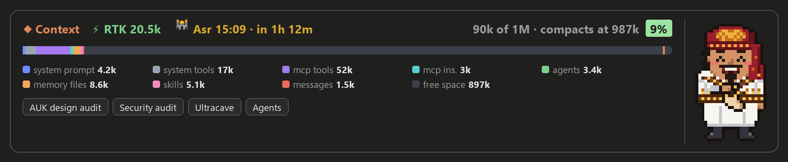
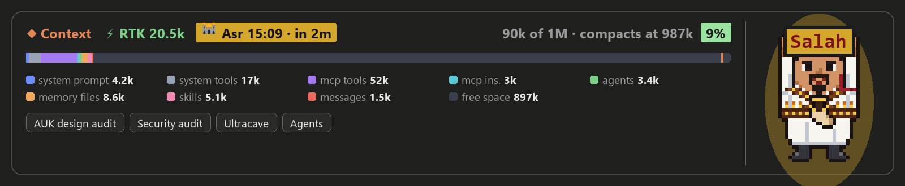
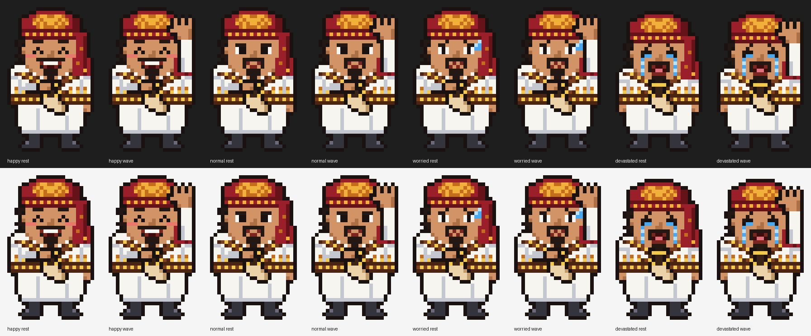

# Context Mod Companion

A Claude Code mod that puts one card above the prompt box: your context window by category, your [RTK](https://github.com/rtk-ai/rtk) token savings, the next Islamic prayer time, and four one-click actions. A pixel Yemeni companion stands in the card. His mood follows how much context you have left, and he calls "Salah" when a prayer is due. Its one-click setup also installs RTK and [Matt Pocock's skills](https://github.com/mattpocock/skills).



## Install

Pick one.

### One line (recommended)

Paste into a terminal. It installs the plugin, Matt Pocock's skills and RTK, hooks RTK into Claude Code, and adds the Bash-only line to your CLAUDE.md. Run it again any time; it skips what's already done.

**Windows (PowerShell):**

```powershell
irm https://raw.githubusercontent.com/iyiob96/Context-Mod-Companion/main/install.ps1 | iex
```

**macOS / Linux:**

```bash
curl -fsSL https://raw.githubusercontent.com/iyiob96/Context-Mod-Companion/main/install.sh | sh
```

Then restart Claude Code.

### From the Claude desktop app

1. Paste `https://github.com/iyiob96/Context-Mod-Companion` into the app's plugin settings and install **yemeni-context-band**.
2. Open a new session. The band shows a **Finish setup** row listing what's missing. Click **Finish setup** and it does the rest (see [what setup does](#what-setup-does)).
3. Restart Claude Code.

### From a Claude Code terminal session

```
/plugin install yemeni-context-band --marketplace iyiob96/Context-Mod-Companion
```

Then click **Finish setup** in the band, or run `/yemeni`.

## What setup does

The band checks four things each time a session starts. If any is missing, it shows a **Finish setup** row; `/yemeni` does the same from the prompt.

| Step | How |
| --- | --- |
| Install RTK | Windows: `winget install rtk-ai.rtk`; macOS: `brew install rtk`; Linux: RTK's official install script |
| Hook RTK into Claude Code | `rtk init -g` |
| Bash-only line in your CLAUDE.md | Adds the line below to `~/.claude/CLAUDE.md` once. RTK only compresses output from the Bash tool, and on Windows Claude may use PowerShell instead |
| Matt Pocock's skills | Adds Anthropic's official plugin marketplace if needed, then installs `mattpocock-skills` |

> Use the Bash tool for shell commands (git, npm, builds, tests, linters, docker) so RTK can compress their output. Only use PowerShell for Windows-specific tasks such as winget, .ps1 scripts or the registry.

RTK ([rtk-ai/rtk](https://github.com/rtk-ai/rtk), Apache-2.0) and Matt Pocock's skills are separate projects. Setup installs them from their official sources; this repo doesn't bundle them. Click **Later** to put setup off for the session. The band works without RTK and shows `RTK –`.

After setup, run `/mattpocock-skills:setup-matt-pocock-skills` in a project to set up Matt Pocock's skills there.

## What you get

The band pops up after the first prompt you send in a session.

| Part | What it shows |
| --- | --- |
| Header | ◆ Context · ⚡ RTK tokens saved (from `rtk gain`) · 🕌 the next prayer with a countdown. On the right: tokens used of your window, the auto-compact point and a % used badge |
| Usage bar | Your context window split by category, with a marker where auto-compact kicks in |
| Legend | Five to a row: system prompt, system tools, mcp tools, mcp ins. (MCP server instructions), agents, memory files, skills, messages, free space, each with its token count |
| Buttons | See [Buttons](#buttons) |
| Companion | A chibi Yemeni man in traditional dress (turban, khanjar, bandoliers), behind a thin divider on the right. Click him and he raises his hand and says "Salam" |

### Buttons

| Button | What it does | Shown when |
| --- | --- | --- |
| AUK design audit | Asks Claude to run the `auk-design-auditor` subagent on a document; Claude asks you which file | Always. If the subagent isn't installed, Claude installs it from your local clone of the (private) AUK design system repository and carries on in the same session |
| Security audit | Asks Claude to run the `security-audit` skill ([cloudflare/security-audit-skill](https://github.com/cloudflare/security-audit-skill)) on the project. Claude recommends a targeted or full audit with its rough cost and waits for your yes | Always |
| Ultracave | Runs the caveman plugin's `/ultracave` | caveman is installed |
| Agents | Runs `/agents-info`, which opens savvy-flow's live agents panel or closes it if it's open | savvy-flow is installed |

### Prayer time and the Salah reminder



- **Next prayer:** the header shows the next of Fajr, Dhuhr, Asr, Maghrib and Isha in gold, with a countdown that updates every minute.
- **Reminder:** from 2 minutes before a prayer until 15 minutes after it, the companion raises both hands with a calm face under a bouncing, gold-flashing "Salah" bubble, with a gold glow pulsing behind him. The prayer time turns into a gold chip that counts down ("Asr 15:09 · in 2m"), then up ("Asr now · 6m ago").
- **Where the times come from:** the [Aladhan API](https://aladhan.com/prayer-times-api) with the Umm al-Qura (Makkah) method, for the city in your timezone: Asia/Dubai gives Dubai. The city name is sent to api.aladhan.com once a day; nothing else is.
- **Change the city:** set the `TZ` environment variable to another IANA timezone, such as `Asia/Aden`. Where one timezone covers a whole country, times can be a few minutes off away from the named city.



| Context left | Mood |
| --- | --- |
| More than 80% | Happy: closed-eye grin, rosy cheeks, gentle bob |
| 60–80% | Normal: calm, slight smile, blinks |
| 40–60% | Worried: raised brows, wavy mouth, sweat drop |
| 40% or less | Devastated: tears, wailing, slumped |

During the Salah reminder he always shows the calm face.

The full drawing (bar chart, rounded swatches and badge, animated companion, click to wave, the Salah glow) is for the Claude Code desktop app. In a terminal the band falls back to text blocks, ■ swatches, a │ divider and a half-block pixel companion; the buttons work, clicking him does nothing, and the reminder shows the raised hands and a gold chip without animation.

## Turn it off or on

```
claude plugin disable yemeni-context-band@context-mod-companion
claude plugin enable yemeni-context-band@context-mod-companion
```

## Develop

```
hooks/register.tsx   the band, the companion's drawing and click, buttons, first-run setup
hooks/character.ts   the pixel companion: palette, 24x40 grid per mood and pose (rest, wave, pray)
hooks/prayer.ts      prayer times: city from timezone, Aladhan URL, next prayer, reminder window
hooks/setup.ts       setup steps, texts and plain helpers
types/index.d.ts     state contract
tests/               claude plugin test suites
install.ps1 / .sh    one-line installers
```

Check your changes with:

```
claude plugin validate .
claude plugin test .
```

The companion was drawn from a reference photo of traditional Yemeni dress, in a chunky pixel-art style.

## License

MIT
