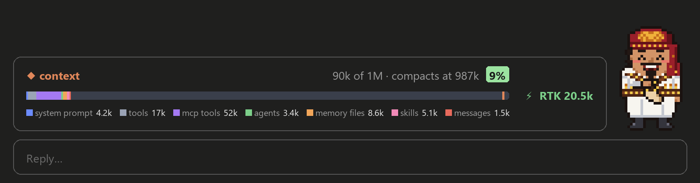
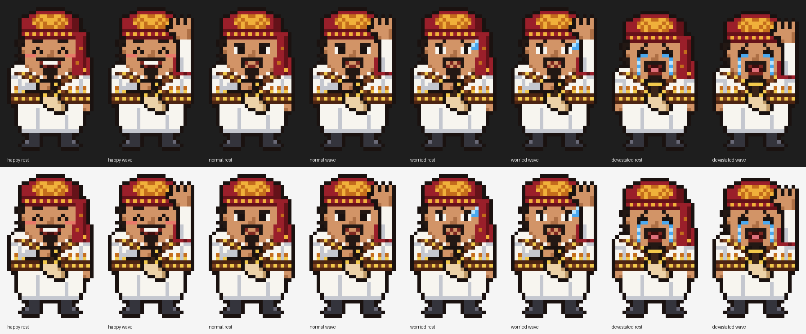

# Context Mod Companion

A Claude Code mod that puts a context-window band above the prompt box. It shows your [RTK](https://github.com/rtk-ai/rtk) token savings, and a pixel Yemeni companion stands beside it. His mood follows how much context you have left. An optional kit installs [Matt Pocock's skills](https://github.com/mattpocock/skills) along with it.



## What you get

| Part | What it shows |
| --- | --- |
| Context | Tokens used out of your window, the auto-compact point, a % used badge, a bar split by category (system prompt, tools, MCP tools, agents, memory files, skills, messages) and a legend with token counts |
| ⚡ RTK | Total tokens RTK has saved, from `rtk gain` |
| Companion | A chibi Yemeni man in traditional dress (turban, khanjar, bandoliers) with no background. Click him and he raises his hand and says "Salam" |

The band pops up after the first prompt you send in a session.



| Context left | Mood |
| --- | --- |
| More than 80% | Happy: closed-eye grin, rosy cheeks, gentle bob |
| 60–80% | Normal: calm, slight smile, blinks |
| 40–60% | Worried: raised brows, wavy mouth, sweat drop |
| 40% or less | Devastated: tears, wailing, slumped |

The full drawing (bar chart, animated companion, click to wave) is for the Claude Code desktop app. In a terminal the band falls back to text blocks and a half-block pixel companion, and clicking him does nothing.

## Install

You need Claude Code with mods support. This repository is private, so the GitHub account you use with Claude Code needs access to it.

This marketplace has two plugins:

| Plugin | What it installs |
| --- | --- |
| `context-companion-kit` | The band **and** [Matt Pocock's skills](https://github.com/mattpocock/skills) (`mattpocock-skills` from Anthropic's official marketplace) |
| `yemeni-context-band` | The band on its own |

### The kit (band + Matt Pocock's skills)

1. Add Anthropic's official marketplace, if you don't have it yet (`claude plugin marketplace list` shows it as `claude-plugins-official`):

   ```
   claude plugin marketplace add https://github.com/anthropics/claude-plugins-official.git
   ```

2. Install the kit. In a **terminal** Claude Code session, type:

   ```
   /plugin install context-companion-kit --marketplace iyiob96/Context-Mod-Companion
   ```

   Answer `y` to add the marketplace, then pick the **user** scope so it loads in every session. Sessions in the desktop app's Code tab pick it up too. The band and Matt Pocock's skills are installed with it.

3. Set up Matt Pocock's skills for your project: run `/mattpocock-skills:setup-matt-pocock-skills`, then `/mattpocock-skills:grill-with-docs` before writing code.

If you skip step 1, the kit installs the band but can't find Matt Pocock's skills. The band still works, and the kit shows as failed to load until you add the official marketplace and run `/reload-plugins`.

### The band only

```
/plugin install yemeni-context-band --marketplace iyiob96/Context-Mod-Companion
```

## RTK (token savings)

RTK is a separate program ([rtk-ai/rtk](https://github.com/rtk-ai/rtk), Apache-2.0). It compresses command output before Claude reads it. This plugin does not bundle RTK. It only reads its numbers. Without RTK the band still works and shows `RTK –`.

Run this once inside Claude Code:

```
/rtk-setup
```

It does three things:

1. **Checks for RTK.** If it's missing, it prints the install command for your OS:
   - Windows: `winget install rtk-ai.rtk`
   - macOS: `brew install rtk`
   - Linux: `curl -fsSL https://raw.githubusercontent.com/rtk-ai/rtk/refs/heads/master/install.sh | sh`
   - Any OS with Rust: `cargo install --git https://github.com/rtk-ai/rtk`
2. **Hooks RTK into Claude Code** with `rtk init -g`, unless that's already done. Restart Claude Code afterwards.
3. **Asks you to keep Claude on Bash.** RTK only compresses output from the Bash tool. On Windows, Claude may use PowerShell and skip RTK. Run `/rtk-setup bash` to add this line to your global `~/.claude/CLAUDE.md`:

   > Use the Bash tool for shell commands (git, npm, builds, tests, linters, docker) so RTK can compress their output. Only use PowerShell for Windows-specific tasks such as winget, .ps1 scripts or the registry.

If RTK isn't found when a session starts, a toast reminds you to run `/rtk-setup`.

## Turn it off or on

```
claude plugin disable yemeni-context-band@context-mod-companion
claude plugin enable yemeni-context-band@context-mod-companion
```

## Develop

```
hooks/register.tsx   the band, the companion's drawing and click, /rtk-setup
hooks/character.ts   the pixel companion: palette, 24x40 grid per mood and pose
hooks/rtk-setup.ts   /rtk-setup texts and plain helpers
types/index.d.ts     state contract
tests/               claude plugin test suites
```

Check your changes with:

```
claude plugin validate .
claude plugin test .
```

The companion was drawn from a reference photo of traditional Yemeni dress, in a chunky pixel-art style.
